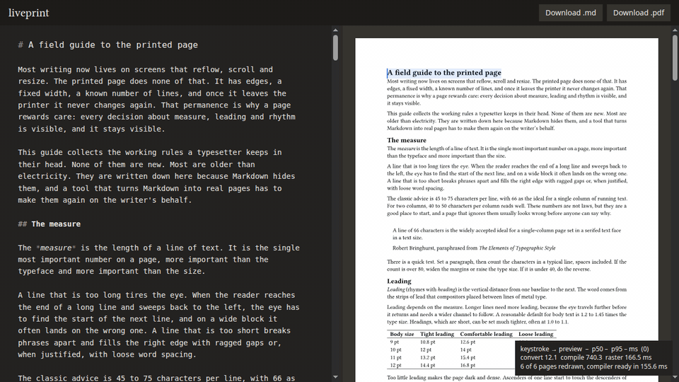

# liveprint



Write Markdown on the left and see the real PDF pages on the right while you type. The preview is the typeset document itself, not an HTML approximation: Typst compiles it in your browser, and **Download .pdf** gives you the same pages you see.

Everything runs on the client. There is no server.

## Speed

Keystroke to updated preview, measured on [`src/sample.md`](src/sample.md) (6 A4 pages, about 3,000 words, with tables, code and LaTeX math):

| Edit | p50 | p95 | Main-thread tasks over 16 ms |
|---|---|---|---|
| Typing inside a heading | 45.2 ms | 59.7 ms | 0 |
| Adding paragraphs near the top, which reflows every later page | 24.9 ms | 65.3 ms | 0 |

Each row is 60 real keystrokes, 150 ms apart, sent to headless Chrome over the DevTools protocol. Chrome used software rendering (SwiftShader) for these runs, so a browser with GPU raster should do at least as well, but that is not measured yet. To reproduce the table, run:

```bash
npm run bench:browser
```

To see the live numbers in the app, press **Alt+D**.

Where the time goes, for a typical keystroke:

- About 2.5 ms converts the Markdown to Typst source.
- About 5–10 ms compiles it incrementally.
- About 23 ms draws the edited page into a bitmap. This is the limiter.
- The rest is messaging and waiting for the next frame.

All of that runs in a Web Worker. The main thread only runs the editor and swaps finished page bitmaps into place, which takes about 0.1 ms. Typing never waits for the preview.

## How it works

1. The editor (CodeMirror 6) sends the full Markdown text to a worker on every change.
2. The worker keeps only the newest edit. Older edits that arrive while it is busy are dropped, never compiled.
3. [`src/convert/toTypst.ts`](src/convert/toTypst.ts) converts the Markdown to Typst source with the same lezer parser the editor uses. Math between `$` signs is passed to [mitex](https://github.com/mitex-rs/mitex), so ordinary LaTeX works.
4. typst.ts compiles the source incrementally and produces a delta of the changed layout.
5. The worker draws the pages whose content changed into `OffscreenCanvas` bitmaps. Visible pages go first. Off-screen pages are drawn afterwards and stop as soon as a newer edit arrives.
6. The main thread puts each bitmap into its page's `<canvas>`. A page keeps its old bitmap until the new one is ready, so the preview never goes blank or flickers.

### Why not cmarker

[cmarker](https://typst.app/universe/package/cmarker) converts Markdown inside Typst and works in typst.ts. liveprint converts in JavaScript instead for two measured reasons:

- cmarker evaluates the whole document again on every keystroke. Its incremental compile took 19.6 ms against 10.8–11.5 ms for the JavaScript path (`npm run bench`).
- Source positions in cmarker's output point into a string it builds at compile time, not into your Markdown. Linking a click in the preview back to the editor needs real positions.

### Why canvas and not SVG

Rendering the pages as one SVG put about 21,000 elements in the page. Chrome then spent about 30 ms of main-thread layout and paint on every frame, including frames where only the editor changed. With the SVG preview, keystroke to preview was 98.7 ms at p50 and the editor stuttered. Moving to per-page canvases drawn in the worker fixed both.

## Two-way linking

Click a word in the preview and the editor cursor moves into that word. Move the cursor in the editor and the preview marks the same place: a pale band over the printed line and a thin bar at the character. If that line is out of sight, the preview scrolls it to a third of the way down, unless you scrolled the preview yourself in the last second.

A Markdown paragraph is usually one long source line, so linking by line would only find the paragraph. liveprint links by character. typst.ts 0.7.0 cannot map a click to the source or back, so liveprint matches the printed text against the Markdown instead:

1. The converter returns the Typst source and every piece of Markdown text it copied into it, with the offset of each piece. Math and generated text, such as list numbers, have no pieces.
2. When a click or a cursor move first needs it after a compile, the worker reads each page's text layer. This is the HTML that typst.ts builds for text selection, with every run of text and its position in points. A page whose typst.ts cache key has not changed keeps the runs it had.
3. Both texts are reduced to lowercase letters and digits, so curly quotes, dashes, hyphenation and ligatures cannot make them differ. A Myers diff pairs the two. On the sample that is 12,370 printed characters against 12,192 Markdown characters, 178 edits apart, which takes about 3 ms.
4. Every printed character now has a Markdown offset. A character the diff did not pair, such as a math glyph or a list number, takes its share of the Markdown between its paired neighbours.

The text layer gives only where a run of text starts and how wide it is. Spreading that width evenly over the characters put words up to 22 pt away from where they print (7 pt median). The worker measures each character in the bundled fonts instead, takes the font whose total comes closest to the run's width, and gives the rest of the width to the spaces, where justification puts it.

Linking did not change keystroke latency measurably. Over five alternating runs per side of `npm run bench:browser`, typing in the title measured 42.7 ms at p50 before and 42.1 ms after, and the reflowing edit 26.9 ms before and 27.1 ms after. Run to run, each varied by 2 to 5 ms. The worker answers linking requests only after it has posted the edited page, and before it draws pages that are off-screen. Rebuilding the index after a one-word edit takes about 7 ms, and a keystroke that arrives during those 7 ms waits for them. The first request after the page loads took 48 ms in one measurement, because it reads all six text layers. A click gets its Markdown offset back in 8 ms at the median.

To check both directions in headless Chrome, run:

```bash
npm run check:linking
```

It samples 28 words from all six pages, among them a table cell, a code token, a list item and a word right after inline math. It clicks each word in the preview and checks that the editor cursor lands inside it. Then it puts the cursor inside the word and checks that the bar in the preview lies inside the printed word. The printed word's box comes from the page's pixels, not from the text layer, so the check does not test the index against itself.

## Run it

```bash
npm install
npm run dev
```

Other scripts:

- `npm test` runs the converter, linking, scheduler and compile tests.
- `npm run build` type-checks and builds to `dist/`.
- `npm run bench` compares compile cost of cmarker and the JavaScript converter in Node.
- `npm run bench:browser` measures keystroke latency in headless Chrome.
- `npm run check:linking` checks clicking in the preview and following the cursor in headless Chrome.
- `npm run record:demo` records `docs/demo.gif` in headless Chrome. It needs `ffmpeg`.

## Status

The pipeline works end to end, the speed is measured, and the editor and the preview link both ways. Not built yet:

- Page settings and themes.
- Offline support and opening and saving local files.
- Images. Image syntax renders its alt text for now.
- Text selection in the preview.

Known limits:

- The compiler WebAssembly is 28 MB, or 10.8 MB gzipped, so the first load is slow until a service worker caches it.
- Linking inside math is approximate. A click on a formula puts the cursor in its LaTeX in proportion to the glyph's position, not on the matching symbol.
- A LaTeX formula that is not valid yet, such as `\frac{1` while you type, stops the compile. The preview keeps the last good pages and shows the error until the formula is valid again.

## Licence

liveprint is released under the [MIT licence](LICENSE).

### Bundled assets

Bundled fonts and Typst packages are listed with their licences in [`public/fonts/LICENSES.md`](public/fonts/LICENSES.md) and [`public/packages/PROVENANCE.md`](public/packages/PROVENANCE.md).
